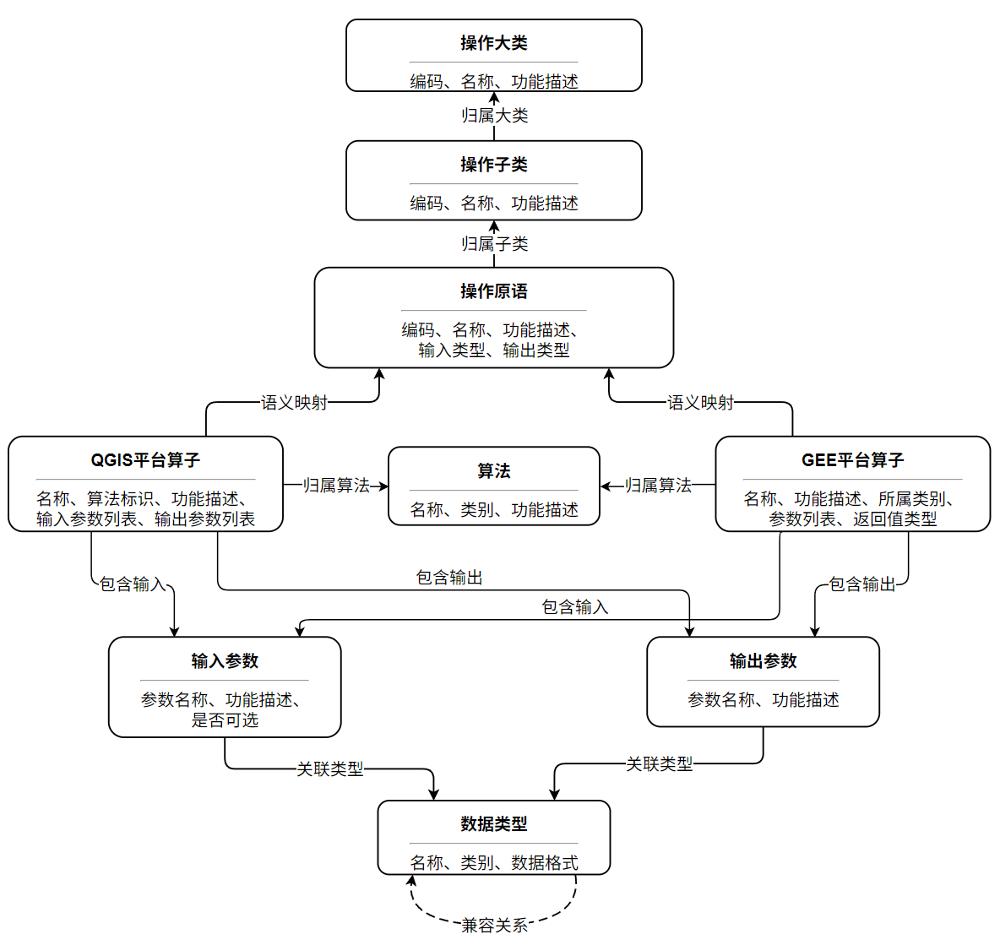
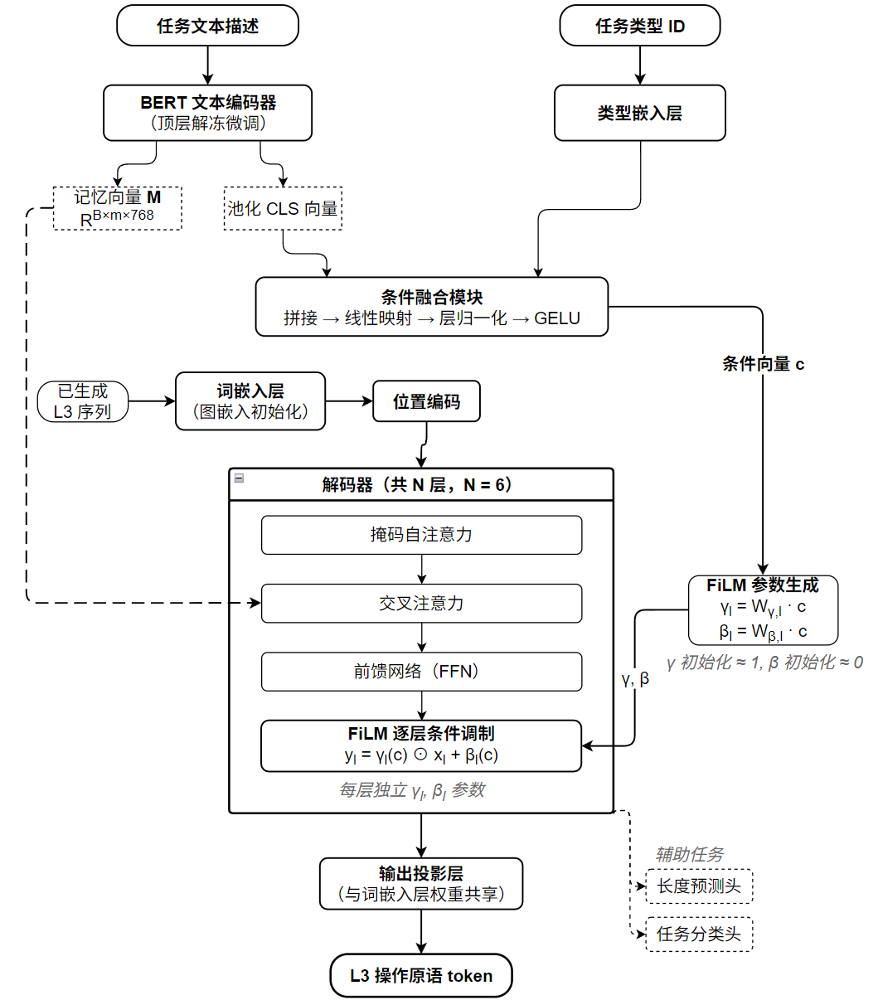
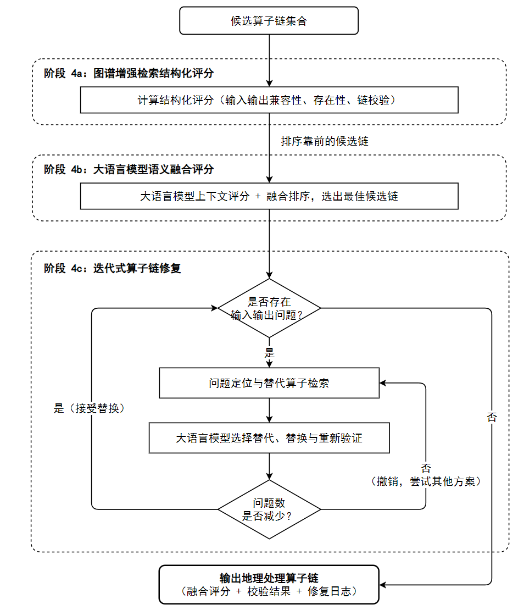

<!-- 由 docx_to_md.py 自 5.22修订版-基于跨平台语义解耦与图谱大模型协同的地理处理模型自动构建方法.docx 转换，勿手改本行元信息 -->

本发明公开了一种基于跨平台语义解耦与图谱大模型协同的地理处理模型自动构建方法，属于计算机与地理信息系统技术领域。所述方法包括：构建面向地理处理任务的条件化序列生成模型CSG\-Geo及其约束推理机制；所述模型基于Transformer解码架构，通过融合任务文本语义、任务类型信息及知识图谱中的结构化语义约束构建统一条件表示，并在生成过程中引入约束感知调制机制，使生成结果满足数据依赖关系及类型约束；基于所述模型与知识图谱协同推理，对用户输入的自然语言地理处理任务进行语义解析，构建结构化语义表示；在此基础上生成候选处理流程，并结合目标平台算子映射关系转换为候选算子链；通过语义与结构约束对候选算子链进行筛选，并基于多源约束执行优化与迭代修复，获得满足语义一致性与结构可执行性的最优算子链及对应的自动化模型结构。本发明通过构建平台无关的操作语义空间，将不同来源的地理处理算子统一抽象与编排，降低了直接面向特定平台算子建模的依赖，并通过图谱与大模型协同推理提升了生成结果的结构合理性与可执行性，实现了从自然语言任务描述到地理处理模型的自动构建。

图 1：系统总体流程示意图

1. 一种基于跨平台语义解耦与图谱大模型协同的地理处理模型自动构建方法，其特征在于，所述方法包括：

构建面向地理处理任务的条件化序列生成模型CSG\-Geo（Conditional Semantic Generation for Geo\-processing）；

所述模型基于Transformer解码架构，通过融合任务文本语义、任务类型信息及知识图谱中的结构化语义约束构建统一条件表示，并在生成过程中引入约束感知调制机制，使生成过程受到数据依赖关系及数据类型约束的协同调控；

基于所述模型与知识图谱协同推理，对用户输入的自然语言地理处理任务进行语义解析，构建结构化语义表示；

在此基础上生成候选处理流程，并结合目标平台算子映射关系转换为候选算子链；

通过语义与结构约束对候选算子链进行筛选，并基于多源约束执行优化与迭代修复，获得满足语义一致性与结构可执行性的最优算子链及对应的自动化模型结构。

2\. 根据权利要求1所述的方法，其特征在于，所述模型是以构建基于Transformer解码器的条件化序列生成模型，具体包括文本编码模块、条件融合模块、条件化解码模块及输出投影模块；

所述文本编码模块用于对原始任务描述进行编码，提取任务文本的语义表示；

所述条件融合模块用于融合任务文本语义表示、任务类型表示及知识图谱中的结构化语义约束信息，生成统一的任务条件表示；

所述条件化解码模块包含多层Transformer解码层，在解码过程中通过特征级线性调制机制将所述任务条件表示与知识图谱约束信息联合注入解码过程，使生成过程在操作语义空间中受到输入输出依赖关系及数据类型约束的协同调控；

所述输出投影模块用于将解码器隐藏状态映射至操作原语输出空间，并计算操作原语的条件生成概率。

3\. 根据权利要求2所述的方法，其特征在于，所述平台无关的操作语义空间由操作原语层次化体系及操作原语与具体平台算子之间的映射关系共同构建；所述操作原语层次化体系按照功能语义将地理处理操作划分为操作大类、操作子类及操作原语三级结构，其中操作大类表示地理处理的功能领域，操作子类表示同一功能领域下的具体操作类别，操作原语表示不可再分的原子操作单元；所述操作原语与具体平台算子之间的映射关系基于预构建的知识图谱建立，用于将不同平台中语义等价或近似等价的算子统一对齐至所述操作原语。

4\. 根据权利要求3所述的方法，其特征在于，所述构建结构化语义表示方法包括：对用户输入的自然语言地理处理任务进行语义解析，提取任务意图及约束信息，生成结构化语义表示；基于预定义的任务类型词表，通过语义相似度计算确定所述任务对应的任务类型标识；并将所述任务类型标识、结构化语义表示及任务文本语义表示共同作为输入，用于构建条件化序列生成模型的结构化语义特征。

5\. 根据权利要求4所述的方法，其特征在于，所述基于条件化序列生成模型在操作语义空间内生成候选操作原语序列的过程包括：预先基于操作原语层次结构、训练样本中的相邻操作原语转移统计信息以及相邻步骤输入输出数据类型关系，构建操作原语转移合法性约束，用于描述不同操作原语之间的允许转移关系；在生成过程中，利用所述条件化序列生成模型以自回归方式逐步生成操作原语序列，在每一时间步，根据任务类型标识、已生成操作原语序列的层次归属关系、所述操作原语转移合法性约束以及相邻步骤输入输出数据类型约束，构建候选操作原语集合，并对不满足操作大类一致性、操作子类可衔接性、转移合法性或输入输出数据类型兼容性约束的候选操作原语进行筛选，生成满足任务语义一致性及操作结构约束的候选操作原语序列。

6\. 根据权利要求5所述的方法，其特征在于，所述将所述候选操作原语序列映射为目标平台中的候选算子链具体包括：对所述候选操作原语序列中的每个操作原语，在前述已建立的映射关系基础上，从所述知识图谱中检索与其相关联且属于目标平台的具体算子集合；对检索到的每个候选算子，基于语义相似度计算映射评分；在逐步映射过程中，引入统一约束函数对候选算子链进行约束建模，并在同一评分空间中进行融合；

在候选算子链生成过程中，采用基于搜索的路径扩展策略，将所述语义匹配评分与所述统一约束函数联合引入路径评分函数，对候选算子链进行累积评分,基于所述评分对候选路径进行排序并筛选高评分结果；

进一步地，在映射过程中统计操作原语映射覆盖度，并结合预设关键位置约束对候选路径进行筛选；当某一操作原语不存在可映射算子时，引入带有功能类别标签的占位符节点以维持算子链结构完整性。

7\. 根据权利要求6所述的方法，其特征在于，所述基于多源约束对候选算子链进行评估与优化的过程包括：基于知识图谱对候选算子链进行结构一致性评估，并结合大语言模型对其语义一致性进行评估，形成综合评分；基于所述综合评分选取得分较优的候选算子链，并针对其中存在的输入输出不兼容或局部链路不合法位置，采用基于操作原语层次结构的分级回退修复策略进行替代优化；所述修复策略优先在同一操作原语范围内检索候选算子，当不存在满足约束的候选算子时，在同一操作子类范围内检索替代操作原语并重新执行算子映射；在替换后对算子链进行一致性评估，并根据不兼容问题及映射覆盖度变化执行回滚控制；其中，所述分级回退修复策略依托于操作原语的三级层次结构，使修复过程在语义相关性逐级扩展的同时保持结构约束一致性，从而形成区别于通用局部搜索回滚方法的约束驱动优化机制。

__基于跨平台语义解耦与图谱大模型协同的地理处理模型自动构建方法__

__技术领域__

本发明属于计算机和地理信息系统GIS（Geographic Information System）领域，具体涉及一种基于跨平台语义解耦与图谱大模型协同的地理处理模型自动构建方法。

__背景技术__

地理信息系统（Geographic Information System，GIS）是进行空间数据处理与分析的重要工具，其核心功能通常通过一系列地理处理算子实现。为完成复杂的空间任务，用户往往需要将多个算子按照逻辑顺序进行组合，形成完整的地理处理模型，用以支撑数据处理、空间分析等任务。

目前主流GIS软件的建模工具，如ArcGIS ModelBuilder与QGIS Graphical Modeler，通常依赖用户以图形化界面的方式手动拖拽算子并配置参数，以构建地理处理模型。此类方法虽然直观，但高度依赖用户的专业知识与经验，构建效率低，且难以保证算子组合的科学性与最优性。

近年来，研究者尝试利用语义检索、图神经网络、大语言模型等技术实现地理处理模型的自动构建。基于语义检索的方法通常只能检索单个或少量候选算子，难以生成具有逻辑顺序的完整处理链；基于图神经网络的方法依赖预先构建的候选算子子图，难以面向完整地理处理流程进行端到端生成；基于大语言模型的方法虽具有较强的自然语言理解能力，但缺乏面向地理处理链构建的专用结构约束，生成结果的输入输出兼容性、数据流连贯性及目标平台可执行性难以得到保证。 

此外，现有方法大多直接面向特定GIS平台的具体算子进行推荐或生成，不同平台的算子在命名方式、功能粒度和参数定义上存在显著差异，导致模型难以在不同平台之间迁移复用。与此同时，地理处理任务涉及矢量、栅格、表格、影像等多种空间数据类型，不同处理步骤之间通常具有严格的输入输出依赖关系和数据流衔接要求。若缺乏统一的操作抽象层和结构化约束机制，生成结果即使在语义上相关，也可能因前后步骤不兼容而无法执行。因此，如何建立跨平台统一的操作表示，并在生成过程中同时兼顾任务语义一致性、空间处理链结构约束及目标平台可执行性，是地理处理模型自动构建中亟待解决的关键问题。

同时，将基于Transformer的自回归序列生成模型直接应用于地理处理操作序列生成时，还面临训练阶段与推理阶段输入分布不一致的问题，预测误差可能随序列步数逐步累积，导致生成序列的顺序与结构偏离合理范围。因此，仍需要在生成过程中有效融入任务条件信息、知识图谱约束以及输入输出类型约束，以提高生成结果的结构合理性和可执行性。

上述两方面问题在面向多业务场景的时空智能计算平台中尤为突出：一方面，不同来源的地理处理算子在表示方式与接口规范上难以统一，跨平台迁移与组合面临显著障碍；另一方面，面向复杂时空任务的序列生成模型若缺乏任务条件与结构约束的协同注入，其生成结果的合理性与可执行性难以保证。以生态遥感监测、灾害预警与应急等能源行业典型应用为例，单个业务任务通常需要跨越遥感影像处理、空间叠加分析、气象数据融合、AI模型推理及成果可视化等多个处理阶段，涉及影像、栅格、矢量、表格、时序数据等多种空间数据类型。在此过程中，平台需要调度和组合来自不同来源的地理处理算子，包括平台自有的基础分析算子库、遥感监测算子库及业务专题算子库中的内部算子、第三方容器化部署的算子服务、以及QGIS、Google Earth Engine等外部GIS平台提供的特定处理能力。上述算子来源各异，在命名方式、功能粒度和参数定义上均存在显著差异，且不同算子之间在输入输出数据类型和空间参考上存在严格的依赖与兼容约束。目前，此类多源算子的跨场景组合与流程编排主要依赖人工经验完成，用户需要在不同算子来源之间手动查找、适配并串联算子，构建效率低，且编排方案固化、适应性弱、扩展困难，难以满足多业务场景下对时空计算任务敏捷响应和智能生成的需求。

综上所述，现有技术在地理处理模型自动构建过程中，仍存在多源算子表示不统一与跨平台操作难以迁移、缺乏面向地理处理链的专用生成机制、难以同时兼顾任务语义理解与结构约束、以及编排方案固化导致生成结果可执行性不足等问题，亟需一种新的技术方案加以解决。

__发明内容__

有鉴于此，本发明提出了一种基于跨平台语义解耦与图谱大模型协同的地理处理模型自动构建方法，通过构建平台无关的统一操作语义空间，实现对多源异构算子的统一抽象，训练面向地理处理任务的条件化序列生成模型，并在推理阶段引入任务条件约束与操作结构约束，结合目标平台算子映射及修复优化机制，实现从自然语言任务描述到结构合理且可执行的地理处理模型的自动构建。

本发明第一方面，公开了一种基于跨平台语义解耦与图谱大模型协同的地理处理模型自动构建方法，所述方法包括如下步骤：

构建面向地理处理任务的条件化序列生成模型CSG\-Geo；

所述模型基于Transformer解码架构，通过融合任务文本语义、任务类型信息及知识图谱中的结构化语义约束构建统一条件表示，并在生成过程中引入约束感知调制机制，使生成过程受到数据依赖关系及数据类型约束的协同调控；

基于所述模型与知识图谱协同推理，对用户输入的自然语言地理处理任务进行语义解析，构建结构化语义表示；

在此基础上生成候选处理流程，并结合目标平台算子映射关系转换为候选算子链；

通过语义与结构约束对候选算子链进行筛选，并基于多源约束执行优化与迭代修复，获得满足语义一致性与结构可执行性的最优算子链及对应的自动化模型结构。

在以上技术方案的基础上，优选的，所述模型是以构建基于Transformer解码器的条件化序列生成模型，具体包括文本编码模块、条件融合模块、条件化解码模块及输出投影模块；

所述文本编码模块用于对原始任务描述进行编码，提取任务文本的语义表示；

所述条件融合模块用于融合任务文本语义表示、任务类型表示及知识图谱中的结构化语义约束信息，生成统一的任务条件表示；

所述条件化解码模块包含多层Transformer解码层，在解码过程中通过特征级线性调制机制将所述任务条件表示与知识图谱约束信息联合注入解码过程，使生成过程在操作语义空间中受到输入输出依赖关系及数据类型约束的协同调控；

所述输出投影模块用于将解码器隐藏状态映射至操作原语输出空间，并计算操作原语的条件生成概率。

在以上技术方案的基础上，优选的，所述平台无关的操作语义空间由操作原语层次化体系及操作原语与具体平台算子之间的映射关系共同构建；所述操作原语层次化体系按照功能语义将地理处理操作划分为操作大类、操作子类及操作原语三级结构，其中操作大类表示地理处理的功能领域，操作子类表示同一功能领域下的具体操作类别，操作原语表示不可再分的原子操作单元；所述操作原语与具体平台算子之间的映射关系基于预构建的知识图谱建立，用于将不同平台中语义等价或近似等价的算子统一对齐至所述操作原语。

在以上技术方案的基础上，优选的，所述构建结构化语义表示方法包括：对用户输入的自然语言地理处理任务进行语义解析，提取任务意图及约束信息，生成结构化语义表示；基于预定义的任务类型词表，通过语义相似度计算确定所述任务对应的任务类型标识；并将所述任务类型标识、结构化语义表示及任务文本语义表示共同作为输入，用于构建条件化序列生成模型的结构化语义特征。

在以上技术方案的基础上，优选的，所述基于条件化序列生成模型在操作语义空间内生成候选操作原语序列的过程包括：预先基于操作原语层次结构、训练样本中的相邻操作原语转移统计信息以及相邻步骤输入输出数据类型关系，构建操作原语转移合法性约束，用于描述不同操作原语之间的允许转移关系；在生成过程中，利用所述条件化序列生成模型以自回归方式逐步生成操作原语序列，在每一时间步，根据任务类型标识、已生成操作原语序列的层次归属关系、所述操作原语转移合法性约束以及相邻步骤输入输出数据类型约束，构建候选操作原语集合，并对不满足操作大类一致性、操作子类可衔接性、转移合法性或输入输出数据类型兼容性约束的候选操作原语进行筛选，生成满足任务语义一致性及操作结构约束的候选操作原语序列。

在以上技术方案的基础上，优选的，所述将所述候选操作原语序列映射为目标平台中的候选算子链具体包括：对所述候选操作原语序列中的每个操作原语，在前述已建立的映射关系基础上，从所述知识图谱中检索与其相关联且属于目标平台的具体算子集合；对检索到的每个候选算子，基于语义相似度计算映射评分；在逐步映射过程中，引入统一约束函数对候选算子链进行约束建模，并在同一评分空间中进行融合；

在候选算子链生成过程中，采用基于搜索的路径扩展策略，将所述语义匹配评分与所述统一约束函数联合引入路径评分函数，对候选算子链进行累积评分，基于所述评分对候选路径进行排序并筛选高评分结果；

进一步地，在映射过程中统计操作原语映射覆盖度，并结合预设关键位置约束对候选路径进行筛选；当某一操作原语不存在可映射算子时，引入带有功能类别标签的占位符节点以维持算子链结构完整性。

在以上技术方案的基础上，优选的，所述基于多源约束对候选算子链进行评估与优化的过程包括：基于知识图谱对候选算子链进行结构一致性评估，并结合大语言模型对其语义一致性进行评估，形成综合评分；基于所述综合评分选取得分较优的候选算子链，并针对其中存在的输入输出不兼容或局部链路不合法位置，采用基于操作原语层次结构的分级回退修复策略进行替代优化；所述修复策略优先在同一操作原语范围内检索候选算子，当不存在满足约束的候选算子时，在同一操作子类范围内检索替代操作原语并重新执行算子映射；在替换后对算子链进行一致性评估，并根据不兼容问题及映射覆盖度变化执行回滚控制；其中，所述分级回退修复策略依托于操作原语的三级层次结构，使修复过程在语义相关性逐级扩展的同时保持结构约束一致性，从而形成区别于通用局部搜索回滚方法的约束驱动优化机制。

本发明相对于现有技术具有以下有益效果：

1）本发明通过构建平台无关的统一操作语义空间，将不同来源的地理处理算子统一抽象至操作原语层次体系，使模型在统一语义空间中进行序列生成，降低了直接面向多源异构算子建模的学习复杂度，并提高了方法对不同来源算子的通用编排能力与跨平台可迁移性。

2）本发明通过构建面向地理处理任务的条件化序列生成模型，将知识图谱语义先验融合于操作原语表示中，并采用任务条件驱动的解码调制机制，使模型能够在统一的操作语义空间内进行候选操作原语序列生成，从而提高生成结果对任务目标的适配性与语义一致性。

3）本发明通过在推理阶段引入操作原语转移合法性约束、层次归属约束及输入输出类型约束，对候选操作原语进行筛选，能够有效抑制不满足结构要求的生成路径，从而提高候选操作序列的结构合理性与后续执行可行性。

4）本发明通过结合目标平台算子映射、映射覆盖度校验、多源评估及替代修复机制，实现了从自然语言任务描述到可执行地理处理模型的自动构建，有效保证了生成算子链的结构合理性与可执行性，并提高了地理处理模型构建的自动化水平与智能化程度。

5）本发明通过构建跨平台统一的操作语义空间和场景相关的知识图谱约束体系，能够在能源时空业务场景下，将用户输入的自然语言任务描述自动转换为跨平台可执行算子链，减少了人工在不同来源算子之间手动查找、适配和串连的步骤，降低了因多源算子输入输出类型不兼容导致的执行失败风险，提升了遥感监测、生态评估、灾害预警等复杂地理处理任务的建模效率和跨场景复用能力。

__附图说明__

为了更清楚地说明本发明实施例或现有技术中的技术方案，下面将对实施例或现有技术描述中所需要使用的附图作简单地介绍，显而易见地，下面描述中的附图仅仅是本发明的一些实施例，对于本领域普通技术人员来讲，在不付出创造性劳动的前提下，还可以根据这些附图获得其他的附图。

图1为系统总体流程图

图2为知识图谱模式结构图

图3为条件化序列生成模型架构

图4为多阶段融合推理与链修复流程图

__具体实施方式__

下面将结合本发明实施方式，对本发明实施方式中的技术方案进行清楚、完整地描述，显然，所描述的实施方式仅仅是本发明一部分实施方式，而不是全部的实施方式。基于本发明中的实施方式，本领域普通技术人员在没有做出创造性劳动前提下所获得的所有其他实施方式，都属于本发明保护的范围。

请参阅图1，本发明提出了一种基于操作语义解耦与图谱大模型协同的多源地理处理算子自动编排方法，所述方法包括：

S1、构建面向地理处理任务的条件化序列生成模型\(CSG\-Geo\)及其约束推理机制；在平台无关的操作语义空间中以自回归方式生成操作原语序列，并融合任务语义信息与知识图谱中的结构化语义约束构建统一条件表示，通过约束感知调制机制对生成过程进行约束注入，使生成结果同时满足输入输出依赖关系及数据类型约束。

S11、多源算子获取、平台无关操作原语层次体系构建、映射关系建立及操作语义空间形成。

在本发明的一种实施方式中，为构建平台无关的统一操作语义空间，实现多源异构算子的统一抽象与编排，选取多个地理处理平台的算子作为基础数据来源，所述平台包括QGIS平台和Google Earth Engine（GEE）平台。由于不同平台在算子组织形式、功能粒度及参数表达方式上存在差异，需对相关算子信息进行统一整理与规范化处理。

具体地，首先对算子元数据进行字段层面的统一映射，将不同平台中的算子名称、功能描述及参数列表等信息转换至统一的元数据表示模式；在此基础上，进一步对数据类型进行跨平台对齐，构建统一的数据类型映射关系，将各平台的类型系统映射至平台无关的抽象数据类型集合；同时，对算子参数结构进行规范化处理，包括可选参数标记、默认值定义及参数依赖关系的统一表示。

在此基础上，为实现地理处理模型生成过程中的跨平台统一表示与结构解耦，构建层次化操作原语表示体系，通过建立平台无关的抽象操作空间，使序列生成过程不直接依赖具体平台算子定义，从而降低模型学习复杂度并提升对不同来源算子的泛化能力。所述操作原语体系同时作为统一输出空间，为算子映射及组合提供语义基础。

所述操作原语体系采用三级层次结构，包括操作大类、操作子类及操作原语。其中，操作大类用于表示地理处理的功能领域，操作子类用于表示同一领域下的操作类别，操作原语用于表示语义明确的原子操作。各层级均为平台无关的抽象语义单元，具体平台算子通过映射关系与操作原语建立关联，实现多源异构算子语义对齐。在这一实施方式中，所述层次划分基于操作的功能语义、输入输出数据类型及处理目标进行联合判定：当多个算子具有相同处理目标且输入输出数据类型语义等价时，归属于同一操作原语；当多个操作原语在功能上属于同一类别但在实现方式或适用数据类型上存在差异时，归属于同一操作子类；当多个操作子类属于同一功能领域时，归属于同一操作大类。

所述三级层次结构可形式化表示为一个有向无环层次图，其中节点集合，、、分别表示操作大类、操作子类和操作原语的节点集合，相应的，分别表示对应集合中的单个节点元素；为层间归属关系的边集合，满足如下约束：

其中，表示“对于任意”；表示“存在唯一一个”；表示“满足条件（such that）”；表示从节点指向节点的有向边。即每个操作原语唯一归属于一个操作子类，每个操作子类唯一归属于一个操作大类，从而形成确定性的层次结构。

进一步地，设平台算子集合为，具体算子与操作原语之间的映射关系可表示为，具体算子与操作原语之间的候选映射关系采用联合评分机制进行判定。设具体算子与操作原语的综合匹配得分为：

其中，表示功能描述语义相似度，表示输入输出类型匹配度，表示处理目标一致度，、、为权重系数，满足。

进一步地，所述语义相似度可基于文本表示向量之间的相似度进行计算，例如采用如下形式：

其中，表示具体算子的语义表示向量；表示操作原语的语义表示向量；所述语义表示向量可通过预训练语言模型、领域嵌入模型或其他文本表示方法获得。

当所述评分函数满足预设条件时，建立具体算子与操作原语之间的映射关系。针对同一算子对应多个操作原语的情况，可结合任务语义及输入输出约束信息进行选择或区分，以确定其对应的操作原语表示。基于上述映射关系，序列生成过程在操作原语空间上进行，并在推理阶段通过逆映射关系获取对应的具体平台算子，其形式可表示为：

其中，相关联的具体算子集合，表示具体算子与操作原语之间的一组映射关系对，通过上述反向检索机制，可将生成阶段限制在抽象的操作原语空间中进行，从而降低搜索空间复杂度，同时在执行阶段再映射至具体平台算子，从而实现生成推理过程与具体平台执行的解耦。

在本发明的一种实施方式中，所述操作原语层次体系基于多源公开算子资料以及能源时空业务场景需求共同构建。具体地，QGIS平台算子元数据来源于QGIS官方文档，Google Earth Engine（GEE）平台相关算子及处理流程样本来源于公开代码仓库、公开网站及已发表论文等公开资料；在此基础上，结合能源时空信息平台中矿区生态变化分析、遥感监测、分区统计、轨迹分析及风险评估等典型业务任务，对算子能力进行功能语义归纳，形成面向能源时空业务场景的操作原语层次体系。

在该层次体系中，可按照地理处理能力将操作原语归纳为时空基础分析类、遥感监测分析类及时空业务分析类。其中，时空基础分析类用于表征矢量分析、栅格计算、轨迹分析及气象分析等基础地理处理能力；遥感监测分析类用于表征光谱分析、SAR数据处理、云掩膜、指数计算及变化检测等遥感处理能力；时空业务分析类用于表征路径规划、轨迹异常识别、生态评估及气象风险评估等面向具体业务场景的分析能力。

上述来自不同平台和公开资料的算子经过字段规范化、数据类型对齐及功能语义抽象后，被统一映射为平台无关的操作原语。例如，栅格裁剪、栅格计算和区域统计等算子可被抽象为对应的基础分析类操作原语；影像筛选、云掩膜、光谱指数计算和变化检测等遥感算子可被抽象为遥感监测分析类操作原语；轨迹聚合、异常识别、路径分析和气象风险评估等算子可被抽象为时空业务分析类操作原语。同时，上述操作原语及算子之间的映射关系、算子所属平台信息、算子适用的能源业务场景信息以及算子的输入输出数据类型信息均通过知识图谱进行结构化建模，使后续序列生成模型能够基于知识图谱中的语义先验和结构约束，感知不同操作原语在能源时空业务场景中的语义关联与数据类型兼容关系，从而为跨平台算子链的自动生成提供场景相关的语义约束基础。

S12、知识图谱构建及数据类型兼容关系建立。

在本发明的一种实施方式中，为实现操作语义结构及算子关系的统一组织与高效检索，将所述构建的操作原语层次结构及算子映射关系进行图结构化建模，构建面向地理处理任务的知识图谱。所述知识图谱包括算子节点、操作原语节点、输入节点、输出节点、数据类型节点、算法节点、平台节点及业务场景节点，并建立算子与输入、输出参数的关联关系，算子与操作原语的映射关系，算子与平台的所属关系，算子与业务场景的适用关系，参数与数据类型的类型关系，以及算子与算法的归属关系。同时，在数据类型节点之间建立兼容关系，用于支持算子链构建过程中输入输出一致性的判定。

如图2所示，为实现算子间语义关系的统一表达与高效推理，所述知识图谱采用图数据库进行存储与管理，通过节点、关系及属性对算子信息及其语义关联进行结构化建模。优选地，采用Neo4j图数据库对算子、操作原语、平台、业务场景、输入输出参数、数据类型及其关系进行统一组织；其中，算子节点通过映射关系连接操作原语节点，通过所属关系连接平台节点，通过适用关系连接业务场景节点，并通过输入输出参数节点及数据类型兼容关系支撑跨平台算子链构建过程中的结构约束分析。

S13、条件化序列生成模型总体架构。

在本发明的一种实施方式中，基于所述操作原语集合与所述知识图谱，构建基于Transformer解码器的条件化序列生成模型。所述模型包括文本编码模块、条件融合模块、条件化解码模块及输出投影模块，请参阅图3。

所述模型以任务语义为条件，对操作原语序列进行自回归生成，其输入包括结构化语义表示、任务类型标识以及已生成的操作原语序列，输出为下一时刻操作原语的概率分布，从而形成面向地理处理任务的条件化序列生成模型。

具体而言，各模块功能如下：

（1）文本编码模块：用于对输入任务描述进行语义编码，获得上下文语义表示，并提取表征任务整体语义的全局特征，用于后续条件构建；

（2）条件融合模块：用于融合文本语义表示与任务类型表示，生成任务条件向量，使任务内容语义与任务类别信息在统一表示空间中进行编码，从而对序列生成过程形成全局约束；

（3）条件化解码模块：用于在序列生成过程中引入所述任务条件向量，对解码过程中的隐藏状态进行调制，使生成过程在保持序列建模能力的同时受到任务语义约束，从而生成符合任务目标的操作原语序列；

（4）输出投影模块：用于将解码器输出的隐藏状态映射至操作原语输出空间，计算候选操作原语的生成概率。

在上述模块协同作用下，模型按照自回归方式逐步生成操作原语序列，其概率建模形式如下：

其中，表示在给定条件向量的情况下生成完整操作原语序列的条件概率，表示长度为T的操作原语序列；表示第步生成的操作原语，表示在第t步之前已生成的历史序列；表示由条件融合模块生成的任务条件向量，用于对生成过程进行约束与调制；表示对各时间步条件概率的连乘运算；表示在已生成历史序列及条件向量约束下生成当前操作原语的条件概率。。

S14、文本编码与条件融合。

基于所述文本编码模块，对结构化模板文本进行语义表示建模，将输入的任务描述转换为用于序列生成的上下文语义表示。设输入的结构化文本序列为：

其中，X表示输入的结构化文本序列；表示序列中的第i个元素，用于表示结构化文本中的一个基本单元（包括字段、词或标记）；n表示输入序列的长度；

经文本编码处理后，得到对应的隐藏状态序列：

其中，Encoder\(⋅\)表示文本编码函数，用于将输入序列映射为上下文语义表示；H表示编码后的隐藏状态矩阵；其中表示第i个位置对应的上下文语义向量；d表示隐藏表示的特征维度；表示由实数组成的维矩阵空间，所述文本编码函数可基于预训练语言模型或神经网络编码结构实现，包括但不限于 Transformer 编码器结构。

为在保证语义表达能力的同时控制后续解码计算复杂度，对所述隐藏状态序列进行压缩建模处理，从所述隐藏状态序列中提取并构造固定规模的语义记忆表示：

其中，M表示记忆向量矩阵；表示记忆向量的数量，且K<n，d表示语义表示的特征维度；表示由实数组成的维矩阵空间；所述记忆向量矩阵M由隐藏状态序列经过信息选择与聚合操作得到，其在特征维度d上与所述隐藏状态保持一致，而在序列长度维度上由n压缩为K，用于提取输入序列中的关键语义信息。

此外，对隐藏状态序列进行全局聚合，获得任务语义的整体表示：

其中，表示文本语义的全局表示向量；表示序列聚合函数，用于对隐藏状态序列进行全局信息汇聚。

在此基础上，条件融合模块将文本语义表示与任务类型信息进行统一建模。首先，将任务类型标识映射为嵌入向量：

其中，表示任务类型的嵌入向量，表示嵌入映射函数。

进一步地，基于预构建的知识图谱，对操作原语之间的输入输出关系、数据类型约束及操作依赖关系进行结构化编码，得到结构化语义表示：

其中，表示图结构语义表示向量；G表示知识图谱结构；GraphEncoder\(⋅\)表示图编码函数。GraphEncoder基于操作原语之间的输入输出依赖关系及数据类型约束构建邻接结构，并通过图表示学习方法对节点进行语义编码。

随后，将文本语义表示与任务类型嵌入进行拼接，并通过非线性映射函数生成条件向量：

其中，\[·;·\] 表示向量拼接操作，表示多层感知机映射函数；所述条件向量c作为统一的约束表示，在后续序列生成过程中参与各时间步条件概率的计算，对候选操作原语的生成概率分布进行调制，从而实现多源语义信息与结构约束信息的协同作用。。

S15、条件化解码机制。

条件化解码模块用于在序列生成过程中引入任务条件信息，实现对操作原语生成过程的动态调控。所述任务条件信息包括地理处理操作类型、空间数据对象以及输入输出约束等结构化语义特征，用于在操作语义层面对生成过程进行约束。

在这一实施方式中，解码器中的隐藏状态并非通用特征表示，而是在操作语义空间中表征操作原语语义特征的表示，所述语义特征包括操作类型、数据类型及输入输出依赖关系。所述解码模块采用基于Transformer的多层堆叠结构，在各解码层中引入特征级线性调制机制，以实现任务条件向量与知识图谱约束信息对隐藏状态的联合调控。对于第层解码器，其输入隐藏状态记为，通过约束感知调制机制得到调制结果：

其中，表示知识图谱中的结构化语义约束信息， 表示基于任务条件向量c与知识图谱约束信息G生成的缩放系数，表示对应的偏移系数，⊙表示逐元素乘法；

所述缩放参数与偏移参数由任务条件向量与知识图谱约束信息通过约束感知映射函数联合生成，所述映射函数基于操作原语之间的输入输出依赖关系构建，使调制参数与操作语义约束结构保持一致。

经上述调制后得到的隐藏状态作为下一层解码器的输入，从而实现条件信息与结构化语义约束在多层网络中的持续传播。

进一步地，所述调制参数在构造过程中显式结合知识图谱中的操作依赖关系及数据类型约束信息，使调制过程能够反映操作语义层面的结构约束特征。

所述调制参数的生成方式为：

其中，与表示约束感知映射函数，表示第层在任务条件信息c与知识图谱结构约束G共同作用下生成的缩放系数向量，表示第层在任务条件信息c与知识图谱结构约束G共同作用下生成的偏移系数向量。在这一实施方式中，所述映射函数采用参数化线性变换形式，并结合结构化语义约束信息进行扩展，其计算方式为：

其中，表示将任务条件向量c与结构化语义表示进行拼接得到的联合特征表示；,,,为可学习参数。上述计算过程用于将任务语义信息与知识图谱中的结构化约束信息进行融合，并生成与当前解码层相匹配的缩放系数 与偏移系数，从而实现对隐藏状态的条件调制。所述调制参数在生成过程中直接作用于隐藏状态表示，使结构化约束信息以显式方式参与特征计算过程。

进一步地，所述调制机制不仅作用于隐藏状态表示，还作用于操作原语候选空间，在生成概率计算过程中引入基于知识图谱约束的合法性权重函数:

其中，表示在引入结构约束后的候选操作原语的生成概率；表示在第t个时间步经条件调制后的隐藏状态表示；表示操作原语嵌入矩阵，表示操作原语词表大小；表示当前隐藏状态与各候选操作原语嵌入之间的匹配得分；表示基于知识图谱约束计算得到的合法性权重函数；表示对所述权重进行对数变换后引入到归一化前的得分中；softmax\(⋅\)表示对所有候选操作原语的得分进行归一化处理。

所述合法性权重函数用于刻画候选操作原语在当前语义上下文及知识图谱结构约束下的可行性。当候选操作原语不满足输入输出关系或数据类型约束时，其对应的权重值降低，从而在概率计算过程中对该候选项进行抑制；反之，对于满足结构约束的候选操作原语，其权重值保持或提升，从而实现约束信息在生成过程中的内生融合。

为保证模型训练初期的稳定性，所述缩放参数与偏移参数采用如下初始化方式：

使得初始阶段满足：

从而在训练初期使条件调制对隐藏状态的影响较小，避免对模型原有表达能力产生扰动。

进一步地，在解码器输入端对操作原语嵌入向量同样施加一次条件调制，其过程表示为：

其中，为操作原语嵌入表示，为调制后的输入表示，、分别表示输入层对应的缩放参数与偏移参数，该计算过程用于根据任务条件信息与结构化语义约束，对操作原语嵌入表示进行特征级调制，使输入表示在进入解码过程前即完成与任务语义及结构约束的对齐。结合后续位置编码：

其中，表示融合位置编码后的最终输入表示；通过将位置编码函数作用于经条件调制后的输入表示，并与其进行叠加，使输入表示在引入任务语义及结构约束信息的同时，进一步编码序列位置信息，从而实现语义特征与位置特征的统一建模。

通过在输入层及多层解码过程中引入条件调制机制，使任务条件信息在不同语义层级上持续作用，从而提升生成序列在地理处理语义上的一致性及操作流程的结构合理性，使生成结果满足空间数据处理过程中的输入输出约束及操作依赖关系。

所述解码器采用基于Transformer的多层结构，各子层计算过程遵循标准的归一化残差结构及多头注意力机制。

S16、输出投影模块与图谱先验词嵌入。

输出投影模块用于将条件化解码模块输出的隐藏状态映射至操作原语词表空间，从而计算当前时间步各候选操作原语的生成概率，实现从连续表示空间到离散操作序列的映射。所述输出词表由操作原语集合构成，以降低输出空间规模并减少多源异构算子带来的预测歧义。

具体地，在第个时间步，解码器输出的隐藏状态记为，通过线性映射与归一化操作得到概率分布，其计算方式如下：

其中，表示第t步生成的操作原语， 表示已生成的序列，为所述共享的词嵌入矩阵，表示经条件调制后的第t步隐藏状态，所述线性映射结果 表示当前隐藏状态在操作原语词表空间上的匹配得分，softmax\(⋅\)用于对各候选操作原语的得分进行归一化，从而得到对应的生成概率分布。。

在这一实施方式中，所述操作原语词嵌入基于知识图谱进行预训练获得，以引入操作原语之间的层次关系、语义关联关系及共现模式作为语义先验，使模型在概率建模阶段即具备对操作语义结构的感知能力。

进一步地，输出投影矩阵与所述词嵌入矩阵共享参数，从而在输入表示与输出预测之间建立统一的语义表示空间，使知识图谱语义先验在表示学习与概率建模过程中保持一致性，提升操作原语表示的稳定性及泛化能力。

S17、模型训练目标。

为训练所述条件化序列生成模型，采用以操作原语序列生成为主任务的监督学习方式。设真实操作原语序列为，则主训练目标为最大化真实序列的条件生成概率，其对应损失函数为：

其中，表示第t个时间步的真实操作原语，表示在第t步之前的真实序列，表示任务条件向量，P\(⋅\)表示模型在当前条件下对操作原语的生成概率，表示基于序列生成概率的监督学习损失，所述损失函数通过最大化真实操作原语序列的条件生成概率，引导模型学习从任务语义到操作序列的映射关系。

进一步地，为增强模型对操作原语序列结构合理性的建模能力，引入基于操作原语转移关系的结构约束损失。所述结构约束基于训练数据中统计得到的操作原语转移关系构建，对不符合常见操作顺序的候选生成结果进行惩罚，其损失函数可表示为：

其中，表示在前一操作原语条件下的非法转移集合，j表示候选操作原语，表示模型在当前条件下生成候选操作原语j的概率，表示对不符合操作语义约束的转移行为进行惩罚的损失项。所述结构约束损失通过对非法转移集合中的候选操作原语概率进行累加，对不符合常见操作顺序或输入输出依赖关系的生成结果进行惩罚，从而引导模型在训练过程中学习操作原语之间的合理转移关系，提升生成序列的结构一致性。

最终，整体训练目标为多任务加权组合：

其中，表示结构约束损失的权重系数，用于调节主任务损失与结构约束损失之间的平衡关系；表示整体训练目标函数。通过对主任务生成损失与结构约束损失进行加权融合，使模型在学习生成准确性的同时，兼顾操作序列的结构合理性。。

在这一实施方式中，还可引入序列长度预测、任务类型判别等辅助学习目标，对模型进行联合优化，以进一步提升模型对任务语义及生成序列结构的建模能力。

S18、模型训练策略。

为提升模型训练稳定性并缓解训练与推理阶段的不一致问题，采用分阶段渐进式训练策略。

首先，在训练初期采用教师强制（Teacher Forcing）策略，即在每个时间步均使用真实序列作为输入，使模型快速学习基本的序列生成能力。随后，引入计划采样（Scheduled Sampling）机制，使模型逐步从依赖真实输入过渡到依赖自身生成结果，其自回归采样概率可表示为：

其中，表示在当前训练阶段采用模型自身生成结果作为下一步输入的概率；为当前训练步数，为总训练步数，*α*为调节系数，用于控制采样概率的增长速率。

在训练过程中，以概率选择使用模型生成的操作原语作为下一时间步输入，以概率选择使用真实操作原语作为输入，从而实现由教师强制训练向自回归生成的平滑过渡，缓解训练阶段与推理阶段输入分布不一致的问题。。

进一步地，引入基于操作原语序列长度的课程式训练策略。将训练样本按照操作原语序列长度划分为多个阶段，先使用较短序列样本进行训练，再逐步引入较长序列样本，使模型由简单模式逐渐过渡至复杂模式。通过由短到长的渐进式训练方式，使模型在初期优先学习局部操作模式与基础转移关系，在后续阶段逐步学习复杂的全局依赖结构，从而提升序列生成的稳定性与结构合理性。

在具体实现中，所述序列长度划分阈值根据训练数据中序列长度分布自适应确定，优选地，可根据分位数或统计区间对序列长度进行分段划分，从而形成短序列、中等长度序列及完整序列的分阶段训练数据集。各阶段按照预设训练进度逐步切换，或在当前阶段训练损失收敛后进入下一阶段。

S2、通过对用户输入的自然语言地理处理任务进行语义解析，提取任务意图及约束信息，构建结构化语义表示。

S21、地理处理任务语义解析与特征提取。

在本发明的一种实施方式中，接收用户输入的自然语言地理处理任务描述后，对所述任务描述进行语义解析，以识别其中的任务意图、地理处理操作类型、空间数据对象、输入输出需求以及处理约束条件，其中所述处理约束条件包括空间范围、时间范围、数据类型及空间关系约束。

所述语义解析过程采用面向地理信息处理领域的语义解析模型实现，所述模型在通用语言理解能力基础上，引入地理处理操作语义、空间数据对象类别及空间关系表达等领域知识，对自然语言任务描述中的关键语义成分进行识别与结构化抽取。

进一步地，为解决地理处理任务描述中存在的术语歧义、表达不规范及约束描述不一致的问题，在语义解析结果基础上，结合预定义的地理处理术语体系及数据类型规范，对所述操作类型、数据对象及约束条件进行标准化处理，从而获得统一的结构化语义特征表示。

在能源时空业务场景中，所述结构化语义特征可包括矿区范围、监测时间段、遥感影像或矢量边界等数据对象，以及生态变化检测、分区统计、风险评估或成果发布等处理目标，使自然语言任务能够被转换为与业务场景、空间数据类型及目标平台执行能力相对应的结构化输入。

S22、任务类型识别与结构化语义表示构建。

在提取所述结构化语义特征后，基于预定义的地理处理任务类型体系对任务类型进行识别，以使后续序列生成模型能够在统一语义空间中进行处理。

在这一实施方式中，将所述结构化语义特征映射为语义向量表示，并与候选地理处理任务类型的向量表示进行相似度计算，选取相似度最高的候选任务类型作为所述任务类型标识。在获得任务类型标识后，将所述任务类型标识与结构化语义特征进行融合，形成统一的语义表示，并将所述任务类型标识、所述统一语义表示及原始任务描述的文本编码结果作为后续条件化序列生成模型的输入特征。

S3、基于所述结构化语义表示，利用所述条件化序列生成模型在所述操作语义空间内生成满足操作原语转移合法性约束、层次归属关系及输入输出类型约束的候选操作原语序列。

S31、操作原语转移合法性约束构建。

为使平台无关的操作原语层次体系直接参与地理处理任务的推理过程，在本发明的一种实施方式中，基于操作原语层次结构、训练样本中的相邻操作原语转移统计信息以及相邻步骤输入输出数据类型关系，构建操作原语转移合法性约束，用于描述不同操作原语之间的允许转移关系。

在地理空间处理任务中，不同处理步骤之间通常具有明确的数据流衔接要求。当相邻操作之间输入输出数据类型不兼容时，该转移路径不应被视为有效生成路径。因此，将操作原语之间的转移合法性与输入输出数据类型兼容性共同纳入统一约束体系。

在这一实施方式中，所述操作原语转移合法性约束通过操作原语转移合法性矩阵表征。设操作原语集合为，则：

其中，元素表示操作原语向操作原语的转移合法性程度或置信度。所述转移合法性矩阵为基于规则约束与统计信息构建的加权矩阵，其取值反映层次结构约束、训练样本统计规律以及输入输出数据类型兼容关系的综合作用结果。

其中，表示非负实数集合，表示操作原语集合的基数，即操作原语的数量；表示第i个操作原语向第j个操作原语的转移合法性程度，；所述转移合法性矩阵为基于规则约束与统计信息构建的加权矩阵，其取值综合反映操作原语层次结构约束、训练样本中的转移统计规律以及输入输出数据类型兼容关系。

在这一实施方式中，所述转移合法性矩阵可为预先计算得到的静态矩阵，或在推理过程中基于任务上下文信息进行动态调整。

进一步地，所述转移合法性矩阵的构建依据至少包括以下条件：

（1）操作原语在操作大类及操作子类层面满足预定义的层次衔接规则；

（2）在训练样本中存在相邻操作原语转移关系，或符合领域规则允许的处理流程；

（3）前一操作原语的输出数据类型与后一操作原语的输入数据类型兼容，所述数据类型包括矢量、栅格、影像、影像集合、表格及属性字段等。

S32、基于约束机制的候选操作原语筛选与概率重归一化方法。

在获得所述条件生成概率后，为保证生成的操作原语序列满足地理处理任务的结构约束与语义一致性，在解码过程中引入基于多源约束的候选筛选机制。

具体地，在第个时间步，首先基于模型输出的概率分布，构建候选操作原语集合。所述候选集合由以下约束条件共同确定：

（1）任务类型对应的操作大类约束；  
（2）已生成操作原语序列的层次归属关系约束；  
（3）操作原语转移合法性约束；  
（4）相邻步骤输入输出数据类型兼容性约束。

设候选屏蔽向量为，其中满足上述约束条件的候选操作原语对应元素取值为1，否则取值为0，则经约束筛选后的概率分布可表示为：

其中，表示第t步生成的操作原语，表示已生成的序列，表示模型在当前条件下对候选操作原语的原始生成概率分布；表示候选屏蔽向量，其维度与操作原语词表大小一致；⊙表示逐元素乘法，用于将不满足约束条件的候选操作原语对应概率置零；Normalize表示对筛选后的候选集合进行重新归一化，使其满足概率分布约束；表示在引入结构约束后的候选操作原语概率分布。所述计算过程通过将候选屏蔽向量与原始概率分布进行逐元素相乘，对不满足结构约束条件的候选操作原语进行概率抑制或屏蔽，并对剩余候选项进行归一化处理，从而在概率空间内实现约束驱动的候选筛选。

对于不满足约束条件的候选操作原语，其对应概率在筛选过程中被置零或显著降低，从而不参与当前时间步的选择过程。

进一步地，所述筛选与归一化过程等价于在解码过程中对原始概率分布施加结构化约束，使不满足约束条件的生成路径在概率空间中被有效剔除，从而保证生成序列满足地理处理任务中的结构约束与语义一致性。

S33、多候选操作原语序列生成策略。

由于同一地理处理任务在不同平台或不同处理策略下可能存在多条合理处理路径，在本发明的一种实施方式中，在推理阶段采用多候选序列生成策略，以输出多个结构合理且语义相关的候选操作原语序列。

在这一实施方式中，采用基于搜索的序列扩展方法，在每一时间步对满足约束条件的候选操作原语进行扩展，并保留若干得分较高的候选路径。设候选操作原语序列为，其累计生成得分可表示为：

其中，表示第t步生成的操作原语，表示已生成的序列，表示模型在当前条件下对候选操作原语的原始生成概率分布；表示候选序列的累计生成得分。所述累计得分通过对各时间步的对数生成概率进行累加，用于刻画候选序列在整体生成过程中的概率一致性与语义合理性，从而为多候选路径之间的排序与筛选提供依据。

进一步地，在这一实施方式中，可在候选序列扩展与评分过程中引入多样性约束与长度约束机制，其中，通过对不同候选路径在同一时间步选择相同操作原语的情况进行惩罚，以提高候选序列之间的差异性；并通过对偏离预期长度的候选序列进行调节或惩罚，以增强生成结果在结构上的合理性。

在此基础上，可综合考虑序列生成概率、操作原语转移合法性程度、序列长度以及候选序列间差异性构建综合评分函数，使结构约束信息参与候选序列的排序过程，从而获得多个在结构上合理且具有差异性的候选结果。

S4、基于预构建的操作原语与目标平台算子之间的映射关系，将所述候选操作原语序列映射为目标平台中的候选算子链，并在统一约束建模框架下进行筛选。

在这一实施方式中，所述语义一致性约束与结构约束基于统一的操作语义空间进行耦合建模，通过对操作原语之间的语义关系、层次结构及输入输出约束进行联合编码，形成用于约束算子链生成过程的统一约束表示，从而实现对候选算子链的全局一致性控制。

S41、映射检索与语义评分。

在已建立的操作原语与具体算子之间的映射关系基础上，针对目标平台对各操作原语相关联的候选算子集合进行检索，并结合语义匹配程度对候选算子进行排序与筛选。

在本实施方式中，设表示候选操作原语序列中的第个操作原语，以表示目标平台中的候选具体算子。对于S4输出的每条操作原语序列\{\}，系统采用逐步搜索策略，将每个操作原语映射为具体平台算子。对于当前操作原语，从知识图谱中检索所有与其存在映射关系的候选算子集合：

其中，表示与操作原语存在映射关系的候选算子集合；表示目标平台中的具体算子；表示操作原语与具体算子之间的映射关系集合。

对每个候选算子，计算其与操作原语之间的语义匹配评分，所述映射评分优选以语义相似度为基础进行构建：

其中，表示候选算子与操作原语之间的综合映射评分；表示基于语义编码模型计算得到的语义相似度；所述语义相似度用于刻画候选算子与操作原语在功能语义层面的匹配程度，从而为候选算子的排序与筛选提供依据。

S42、统一约束函数建模。

为实现多类型约束的统一表达与协同建模，首先对不同约束进行函数化表示，并将其映射至同一评分空间中，从而构建统一约束函数，对候选算子链的局部结构进行综合评估。所述统一约束函数定义为：

其中，表示相邻步骤中的具体算子；表示对应的相邻操作原语；表示输入输出数据类型兼容约束，表示操作原语转移合法性约束，表示层次结构约束；为权重系数，进一步地，各约束函数具体定义如下：

（1）输入输出兼容约束：

其中，表示算子的输出数据类型集合，表示算子的输入数据类型集合，所述数据类型经归一化处理后进行匹配，为惩罚系数且0<* * <1；

（2）转移合法性约束：

其中，表示基于历史数据或知识图谱构建的操作原语合法转移关系集合。

（3）层次结构约束：

其中，表示操作原语在层次结构中的所属层级，所述合法性基于操作原语三级层次体系中的层间约束关系进行判定。

所述统一约束函数通过对多源结构约束进行加权融合，对候选算子链中相邻步骤的语义一致性与结构合理性进行综合评估，从而为后续算子链筛选与优化提供统一的约束度量。

S43、语义扩展映射机制。

当某一操作原语在知识图谱中不存在直接映射关系时，采用基于语义相似度的扩展检索机制，从全体算子集合中检索语义相近的候选算子：

其中，表示通过语义扩展机制获得的候选算子集合，表示第i个操作原语；表示目标平台中的候选具体算子；表示候选算子与操作原语之间的语义相似度；为语义相似度阈值。该机制用于弥补知识图谱映射覆盖不足的问题，使系统能够在缺失显式映射关系时仍具备候选算子发现能力。

在完成每一步映射后统计当前候选路径中已成功映射至目标平台具体算子的操作原语数量，并结合预设关键位置的映射情况计算映射覆盖度：

其中，表示候选序列的映射覆盖度；候选操作原语序列长度为T，成功映射的操作原语数量为；若所述映射覆盖度低于预设阈值，或关键位置操作原语未映射成功，则记录对应位置的映射缺失信息，以供后续评估与修复阶段使用；当既不存在显式映射关系，也不存在满足语义扩展条件的候选算子时，引入带有功能类别标签的占位符节点，以维持链结构完整性并记录映射缺失信息。

S44、候选算子链生成与评分。

在完成逐步映射后，对每条候选算子链进行整体评分，并将所述映射覆盖度作为筛选阈值，以优先保留映射完整度较高的候选链。设候选链为，其综合评分定义为：

其中，C表示候选算子链；Y表示与候选算子链对应的操作原语序列；表示第i个具体算子；表示第i个操作原语；表示算子与操作原语之间的语义映射评分；表示统一约束函数；表示候选算子链的综合评分。所述综合评分通过对算子与操作原语之间的语义匹配程度以及相邻步骤之间的结构约束一致性进行联合建模，实现对候选算子链在语义合理性与结构完整性两个方面的综合评估。对所有候选链进行排序与去重处理，保留得分最高的前条候选算子链：

其中，表示所有候选算子链的集合；表示预设保留的候选链数量；表示筛选后的候选算子链集合。

最终输出候选算子链集合，每条候选链包含算子序列，对应操作原语序列，映射路径信息以及综合评分，供后续步骤进行进一步优化与执行验证。

所述统一约束函数在候选路径扩展及评分过程中对算子链进行全局一致性评估，使语义约束、结构约束及数据类型约束在同一评分空间中协同作用，从而避免各类约束独立作用所导致的局部最优问题，提高生成算子链的整体结构合理性与语义一致性。

S5、基于多源约束对所述候选算子链进行评估与优化，并针对存在映射缺失或结构不一致的候选算子链进行替代修复，输出最优的地理处理算子链及对应的自动化模型结构。

S51、结构一致性评估。

利用知识图谱对每条候选算子链进行结构化评分，从多个维度衡量算子链的结构合理性与可执行性。对于每条候选算子链，首先基于知识图谱对链中各算子的有效性进行验证，判断各算子是否能够在所述知识图谱中检索到对应节点，并据此统计链中有效算子的占比，用于表征算子链的可识别程度。进一步地，对候选算子链中相邻算子之间的数据流关系进行逐步分析，通过查询前一算子的输出数据类型以及后一算子的输入数据类型，并结合知识图谱中数据类型之间的兼容关系，对相邻算子之间的输入输出匹配情况进行判定，从而统计满足数据类型兼容约束的步骤对占比，用于衡量算子链的数据流连贯性。调用算子链验证模块对候选算子链进行整体一致性校验，从算子连接关系、数据传递路径及执行逻辑完整性等方面进行综合分析，得到对应的结构有效性评分。在此基础上，构建结构一致性评分函数：

其中，*C*表示候选算子链，表示链中各步骤语义映射评分的平均值，表示候选算子链对应原语序列中已成功映射至目标平台具体算子的步骤占总步骤数的比例，表示链中相邻算子间输入输出兼容的比例，表示基于知识图谱对算子链逐步验证所得的验证评分，至为可调权重系数；所述映射覆盖度在映射阶段用于刻画候选操作原语序列向具体平台算子空间的映射完整性，并在本步骤中作为候选算子链的整体特征参与结构一致性评分计算，记为。所述结构一致性评分通过融合语义映射质量、映射完整性、数据流连贯性及结构有效性等多维指标，实现对候选算子链结构合理性与可执行性的统一建模。

S52、语义一致性验证与融合排序。

为验证候选算子链在语义层面是否符合用户任务意图，将候选算子链的结构化描述输入大语言模型进行语义一致性验证。对于每条候选算子链，首先基于知识图谱构建其上下文信息，将链中各算子的功能描述、输入输出参数、数据类型以及相邻算子之间的数据流关系进行组织，形成结构化语义表示，并与用户原始任务描述共同作为大语言模型的输入。大语言模型基于上述输入，从任务语义匹配程度、算子组合顺序合理性、数据流完整性以及冗余程度等多个维度，对候选算子链进行综合评估，输出对应的语义一致性评分。在此基础上，将结构一致性评分作为结构可行性约束，对语义一致性评分进行引导融合，从而得到候选算子链的综合评分，其计算方式如下：

其中，表示候选算子链的综合评分；表示结构一致性评分；表示语义一致性评分；和为可调权重系数。通过将基于知识图谱的结构一致性评分与基于大语言模型的语义一致性评分进行融合，实现结构约束与语义匹配的协同优化。根据综合评分对候选算子链进行排序，选取得分最高的候选链作为当前最优候选链。

S53、迭代式算子链修复。

在最优候选算子链仍存在输入输出不兼容或局部链路不合法时，启动基于层次化操作语义空间的约束驱动修复机制，对算子链进行迭代优化。

所述修复过程在不改变整体操作语义结构的前提下，对存在冲突的局部算子节点进行替代调整，并在预设最大迭代次数约束下执行多轮优化；在每一轮修复过程中，首先基于输入输出关系分析定位存在数据类型不兼容或语义冲突的位置，并确定对应算子节点作为待修复对象；随后，优先在与当前算子对应的同一操作原语范围内检索候选算子，并基于输入输出兼容性约束对其进行筛选，以保证局部替换在语义等价空间内进行；当在同一操作原语范围内不存在满足约束的候选算子时，则在同一操作子类范围内检索满足前后衔接关系的替代操作原语，并基于所述替代操作原语重新执行算子映射及约束筛选，从而实现语义相关性受控扩展下的替代优化；在完成替换后，对更新后的算子链重新执行输入输出兼容性验证、映射覆盖度评估及结构一致性评估，并根据替换前后不兼容问题数量及映射覆盖度变化情况执行回滚控制，当替换后不兼容问题减少，或在不增加不兼容问题的前提下映射覆盖度提高时，保留替换结果，否则撤销本次替换操作并尝试其他候选方案；当算子链中不存在不兼容问题、达到预设最大迭代次数或不存在可行替代方案时终止修复过程。

进一步地，所述修复过程采用“操作原语层级内优先替换—操作子类层级扩展替代—重映射筛选”的分级回退策略，所述策略直接依托于所述操作原语三级层次体系，使搜索空间沿语义层级逐步扩展，在保持语义相关性的同时强化结构一致性约束，从而形成区别于通用局部搜索回滚方法的约束驱动优化机制。

图 1

图 2 

图 3

图 4
